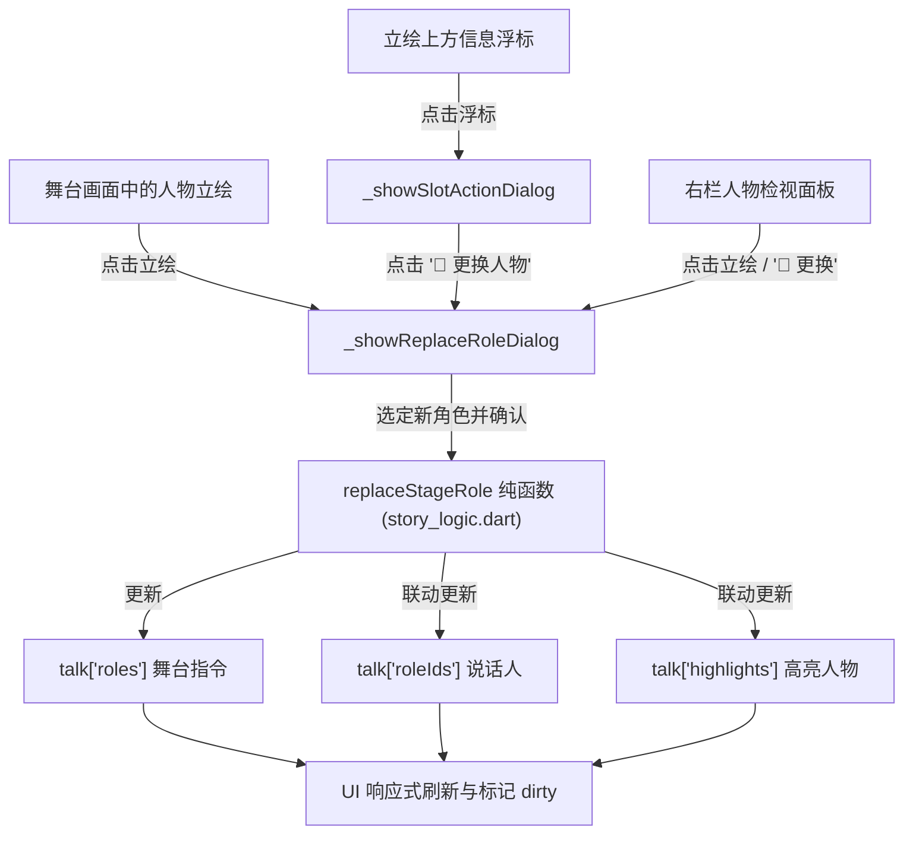

# 导演模式下剧情编辑新增「点击人物更换角色」实施方案

## 需求背景与目标

在导演模式（Director Mode）的剧情编辑工作台（剧情舞台 `StoryStudioEditor`）以及经典导演编排视图（`StoryDirectorView`）中：
- 目前当站位槽位为空时，用户可点击槽位弹出角色选择器放置角色（登场）。
- 但当站位槽位已有角色在场时，用户**点击该人物立绘无法直接进行更换**；若需更换人物，用户通常需要先将原人物退场/移除，再重新点击空槽位选择新人物，交互链较长。
- 此外，站位角色的动作弹窗（表情/翻转/移动）中亦缺少显式的「更换人物」入口，右栏人物检视区也缺少直接换人操作。

**目标**：
在导演模式的剧情编辑中，支持**直接点击在场人物（游戏画面舞台立绘 / 检视区人物）触发更换角色功能**，保留或延续当前站位、表情及镜像配置，同步更新本句说话人（`roleIds`）与高亮（`highlights`），提供直观便捷的选人体验。

---

## 用户需知与设计确认 (User Review Required)

> [!NOTE]
> 1. **点击立绘的交互行为**：
>    - 点击舞台上的在场人物主体（立绘）：直接呼出「更换人物」弹窗（支持人物卡片网格、搜索、表情与站位微调）。
>    - 点击立绘顶部的浮标（角色名·表情）：依旧弹出「表情与站位」微调菜单，并在菜单中新增「🔄 更换人物」快捷按钮。
>    - 右栏人物与表情检视面板：立绘预览区域增加点击更换支持，角色信息行增加「🔄 更换」胶囊按钮。
> 2. **数据写回规则（同口径）**：
>    - **显式在场**（当前台词已包含该角色的 `roles` 指令）：将该角色的指令行（入场、表情、翻转等）中的角色 ID 直接更新为新角色 ID。
>    - **继承在场**（当前台词未含该角色指令，而是从前序台词继承在场）：当前台词写入旧角色滑动退场（`removeStageRole`）并追加新角色在相同站位与表情的入场指令（`setStagePos` + `setStageExpr`）。
>    - **说话人与高亮联动**：若当前台词的说话人（`roleIds`）或高亮（`highlights`）包含原角色，自动将其替换为新角色，保证剧情台词与舞台演员同步。

---

## 架构与改动范围



---

## 详细实施计划 (Proposed Changes)

### 1. 业务逻辑层：`frontend/lib/features/story/story_logic.dart`

#### [MODIFY] `frontend/lib/features/story/story_logic.dart`
- 新增纯函数 `replaceStageRole`，实现老角色替换为新角色的指令行计算：
```dart
/// 替换角色：将舞台指令中的 [oldRoleId] 替换为 [newRoleId]。
/// 
/// - 若原指令中已显式包含 [oldRoleId] 的指令行：
///   将这些指令行的首项角色 ID 改写为 [newRoleId]；
///   若显式指定了 [pos]，确保包含对应的入场站位；
///   若显式指定了 [expr]，确保包含对应的表情指令；
///   若显式指定了 [flip]，确保镜像指令与之匹配。
/// - 若原指令中未显式包含 [oldRoleId]（即角色是由前序台词继承在场）：
///   追加 [oldRoleId] 的退场指令（removeStageRole）；
///   追加 [newRoleId] 的入场指令（setStagePos）；
///   若有表情 [expr]，追加 [newRoleId] 的表情指令（setStageExpr）；
///   若 [flip] 为 true，追加镜像指令。
List<dynamic> replaceStageRole(
  dynamic roles,
  String oldRoleId,
  String newRoleId, {
  int? pos,
  int? expr,
  bool? flip,
});
```

---

### 2. 剧情舞台工作台：`frontend/lib/features/story/story_studio_editor.dart`

#### [MODIFY] `frontend/lib/features/story/story_studio_editor.dart`
1. **扩展 `_StudioPlaceRoleDialog`**：
   - 增加可选参数 `titleText` 与 `confirmButtonText`，使其既能用于「人物登场」，又能自适应为「更换人物：[角色] 角色名」与「确定更换」。
2. **实现 `_showReplaceRoleDialog(Map<String, dynamic> talk, _StudioRolePlacement p)`**：
   - 收集当前人物字典与元数据，传入 `_StudioPlaceRoleDialog`。
   - 确认时调用 `replaceStageRole` 更新 `talk['roles']`。
   - 联动更新 `talk['roleIds']` 与 `talk['highlights']`。
   - 若当前 `_inspectRoleId == p.roleId`，无缝切换为新角色 ID。
   - 触发 `setState(() => _dirty = true)`。
3. **中间舞台站位角色点击（`_buildStagePreview`）**：
   - 将原先不可点击的 `AnimatedOpacity(...) / TexThumb(...)` 立绘组件外层包裹 `MouseRegion(cursor: SystemMouseCursors.click)` + `GestureDetector(behavior: HitTestBehavior.opaque, onTap: () => _showReplaceRoleDialog(talk, p))`。
   - 添加 `Tooltip(message: '点击更换人物 ([$p.roleId] ${_roleName(p.roleId)})')`。
4. **动作弹窗入口扩展（`_showSlotActionDialog`）**：
   - 在弹窗操作行（左移、右移、翻转、高亮）中新增 `_StudioPill(label: '🔄 更换人物', onTap: () { Navigator.of(ctx).pop(); _showReplaceRoleDialog(talk, p); })`。
5. **右栏检视面板入口（`_buildCastPanel`）**：
   - 在检视区大立绘预览图添加点击手势与提示 `Tooltip(message: '点击更换人物')`。
   - 在角色信息行 `[$inspect] 角色名` 旁增加 `_StudioPill(label: '🔄 更换', ...)`。

---

### 3. 经典导演编排视图：`frontend/lib/features/story/story_director_view.dart`

#### [MODIFY] `frontend/lib/features/story/story_director_view.dart`
1. **实现 `_showReplaceRoleToSlotDialog(_StageRoleInfo role, int slotIdx, Map<String, dynamic> talk)`**：
   - 弹出角色选择对话框，选定新角色后通过 `replaceStageRole` 进行原子替换并同步说话人。
2. **舞台站位卡片（`_buildRoleCard`）**：
   - 卡片顶部工具行在「关闭（退场）」按钮左侧增加更换图标按钮（`FluentIcons.arrow_swap_16_regular`，提示「更换人物」）。
   - 立绘展示容器外层包裹 `MouseRegion` 与 `GestureDetector`，点击直接调用 `_showReplaceRoleToSlotDialog`。
3. **表情编辑弹窗（`_showEditRoleActionDialog`）**：
   - 在弹窗中增加「更换角色」操作按钮，方便快捷跳转。

---

## 验证计划 (Verification Plan)

### 1. 自动化单元测试
- **测试用例文件**：`frontend/test/story_replace_role_test.dart`
  - 测试 `replaceStageRole` 针对单句显式角色的替换（角色 ID 替换、位置/表情保持）。
  - 测试 `replaceStageRole` 针对跨对白继承角色的替换（生成旧角色退场 + 新角色入场）。
  - 测试说话人（`roleIds`）与高亮（`highlights`）的同步更新。
- **执行命令**：
  ```pwsh
  flutter test test/story_replace_role_test.dart
  ```

### 2. 自动化组件与界面集成测试
- **回归既有测试**：
  ```pwsh
  flutter test test/story_studio_test.dart
  flutter test test/director_shell_test.dart
  ```
- **验证点**：
  - 确认舞台中已放置角色的立绘包含 `onTap` 点击更换事件。
  - 确认在弹窗中选择新角色后，舞台立绘与 `talk['roles']` 正确变更为新角色。
  - 确认无溢出与布局回归。

### 3. 手动体验走查
1. 切换至「导演」模式，进入「剧情舞台」工作台。
2. 选中任意已有台词，若槽位为空，点击放置一个角色（如主角）。
3. 直接鼠标点击该角色的立绘，观察是否弹出「更换人物」对话框。
4. 在对话框中搜索或点击另一个角色（如 101/老师/同学），点击「确定更换」。
5. 验证舞台上立绘、角色名、说话人 chip 以及右侧检视面板均已同步更新为新角色。
