# 导演模式主页与各卡片工作台对标友商 #2（拾光工坊）同步方案

## 目标概述

对标参考产品（友商 #2 `参考资料/友商产品#2/student-age-studio-main` 拾光工坊），对当前编辑器导演模式（`UiMode.director`）的**主页结构、功能卡片、模组工具栏**以及**点击每个卡片进入的工作台**进行全面系统性同步，消除主页卡片不对齐、缺少功能上下文、多表分类缺失等问题，使导演模式的交互流与对标产品保持 100% 一致。

---

## 现状对比与差距分析

### 1. 主页架构与卡片网格对比

| 模块 / 维度 | 友商 #2（拾光工坊） | 当前实现现状 | 同步方案 |
| :--- | :--- | :--- | :--- |
| **主页功能卡片** | 严格过滤后的 **52 张业务功能卡片**（21 个内置项 + 27 个拓展项 + 4 个素材库卡片） | 54 项基表卡片 + 硬编码追加的 8 张工具卡片（`feat:blocks`、`feat:events` 等），存在重复与不规范卡片 | 严格对齐友商 #2 的 52 张卡片；排除 `native: false` 的管理项（进入模组管理工具栏） |
| **收藏区** | 默认收藏 4 项：`story`（剧情编辑）、`persons`（人物）、`posts`（企鹅动态）、`items`（物品） | 虽读取 `defaultFavorite`，但卡片列表混合了额外硬编码项 | 维持并固化 4 大核心默认收藏，星标持久化保存 |
| **游戏内置编辑器项** | **21 项**（剧情编辑、人物、物品、企鹅动态、特质、结局段落、结局选项、珍贵记忆、行动、目标、商店商品、空间评论、空间主页、开关、闲聊、事件外对话、短信、属性、状态、小游戏、电视节目） | 与拓展项混杂，部分卡片提示显示为「N 张表」而非项数 | 严格分组为 21 项，卡片提示与友商 #2 统一（项数 / 素材目录） |
| **编辑器拓展项** | **27 项**（电影、相亲、全局文本、职业、谈判对手、好友同学、探索、跳蚤市场、早报、追番、钓鱼、旅游、世博会、侦探社、手工、生日派对、谈判队伍、谈判话题、谈判卡组、职业解锁、告白、约会、羽毛球、爱心早餐、抽签、许愿、送礼） | 混杂了文件、云同步、积木库、扫描修复等通用独立工具 | 拓展项纯净化为对标的 27 项，通用工具收归顶部栏与托盘 |
| **模组管理工具** | 4 个操作按钮：`模组信息`、`游戏素材缓存`、`高级配置`、`删除模组` | 模组信息、游戏素材缓存、导出导入、删除模组 | 按钮对齐为「模组信息」、「游戏素材缓存」、「高级配置」（进入 JSON 编辑器）、「删除模组」 |
| **素材库分组** | 4 张卡片：背景图、CG 插画、背景音乐与音效、空间头像 | 仅作为通用配置表卡片展示 | 4 张卡片独立成区，提示「素材目录」，点击直达素材对应分类 |

### 2. 卡片点击进入的工作台路由对比

```mermaid
flowchart TD
    subgraph DirectorHome["导演模式主页 (Home)"]
        C_Story["剧情编辑 (story)"]
        C_Person["人物 (persons)"]
        C_Items["物品 (items)"]
        C_Shops["商店商品 (shops)"]
        C_Posts["企鹅动态 (posts)"]
        C_Comments["空间评论 (comments)"]
        C_Profiles["人物企鹅空间 (profiles)"]
        C_Goals["目标 (goals)"]
        C_Idle["闲聊 (idle-chats)"]
        C_Ext["事件外对话 (external-dialogues)"]
        C_Msg["短信 (messages)"]
        C_Mini["小游戏 (minigames)"]
        C_Res["素材库 (4 类素材卡片)"]
        C_Tables["其他 35 项配置表功能<br/>(8 内置 + 27 拓展)"]
        Tools["模组管理 (4 个按钮)"]
    end

    subgraph Workbenches["目标专属工作台"]
        W_Studio["剧情舞台 (StoryStudioEditor)<br/>三栏舞台编辑"]
        W_Person["人物工作台 (PersonWorkbench)<br/>资料/成长喜好/表情立绘"]
        W_WarehouseItem["物品仓库 (WarehouseWorkbench)<br/>模式: 物品与书籍"]
        W_WarehouseShop["物品仓库 (WarehouseWorkbench)<br/>模式: 商店与商品"]
        W_Social["社交动态 (SocialWorkbench)<br/>动态/评论树/设置"]
        W_Space["空间工作台 (SpaceWorkbench)<br/>主页/留言板/装扮"]
        W_Goals["目标工作台 (GoalsWorkbench)<br/>列表/预览/奖励"]
        W_Idle["闲聊工作台 (IdleChatWorkbench)<br/>闲聊/对白链/预览"]
        W_Ext["外部对话工作台 (ExternalDialoguesWorkbench)<br/>入口/对白链"]
        W_Msg["手机消息工作台 (MessagesWorkbench)<br/>短信/对话树/分支"]
        W_Mini["小游戏库 (MinigamesWorkbench)<br/>定义/关卡/预览"]
        W_Res["素材库 (ResourcesPage)<br/>直达对应素材页签"]
        W_FeatureTable["Feature 配置表工作台 (DirectorFeatureTableView)<br/>带功能上下文 + 多表 Module Tabs"]
        W_Mods["模组信息 (ModsPage)"]
        W_Json["高级/JSON (JsonWorkbench)"]
    end

    C_Story --> W_Studio
    C_Person --> W_Person
    C_Items --> W_WarehouseItem
    C_Shops --> W_WarehouseShop
    C_Posts --> W_Social
    C_Comments --> W_Social
    C_Profiles --> W_Space
    C_Goals --> W_Goals
    C_Idle --> W_Idle
    C_Ext --> W_Ext
    C_Msg --> W_Msg
    C_Mini --> W_Mini
    C_Res --> W_Res
    C_Tables --> W_FeatureTable
    Tools --> W_Mods
    Tools --> W_Json
```



### 3. 配置表工作台的核心设计升级

当前问题：
当点击非专属工作台的配置表功能卡片时（例如点击「职业」`jobs` 或「早报与热搜」`news` 或「追番与漫展」`anime`）：
- **当前现状**：直接调用 `_openTable`，根据底层 `editorPages` 查找归属，导致丢失了卡片的功能标题与描述，且多表功能（如 `jobs` 包含 `JobCfg` + `JobUnlockCfg`，`news` 包含 3 张表，`anime` 包含 10 张表）无法在同一功能界面内方便地切换，右侧信息栏显示了 legacy 分页的不相干表。
- **对标友商 #2**：进入该 Feature 专属的表工作台。顶部显示 `← 全部功能` 面包屑、功能图标、功能标题（如「职业」）与功能说明。当该功能包含多张表时，提供横向分类切换标签栏（Module Tabs），显示每张表的友好名称（如「职业」「职业解锁」），点击无缝切换表，保留搜索、分页与表单编辑。

---

## 详细修改计划

### 1. `frontend/lib/features/pages/workshop_features.dart`

1. **模组管理与素材项标记**：
   - 将 `manifest`（模组信息）和 `resources`（游戏素材）的 `native` 属性设为 `false`，使其不在主页卡片网格中重复渲染（它们归属于底部的「模组管理」工具栏）。
2. **多表功能标签定义（`tableLabels`）**：
   - 对齐友商 #2 的 `tableLabels` 映射，例如：
     - `flea-market`: `{'ExploreCfg': '集市', 'ActionCfg': '集市行动', 'ItemCfg': '物品售价', 'BookCfg': '书籍售价'}`
     - `minigames`: `{'MinigameCfg': '小游戏', 'MinigameActionCfg': '社交关卡', 'HandicraftMiniGameCfg': '手工拼装', 'LineMatchMinigameCfg': '连线', ...}`
     - `jobs`: `{'JobCfg': '职业', 'JobUnlockCfg': '职业解锁'}`
     - `news`: `{'NewsCfg': '早报新闻', 'NewsCommentCfg': '新闻评论', 'NewsTypeCfg': '新闻分类'}`
     - `love-confession`: `{'LoveVindicateCfg': '告白提示', 'LoveVindicateRateCfg': '人物成功率'}`
     - `love-wish`: `{'LoveRibbonCfg': '恋爱飘带', 'WishCfg': '许愿内容'}`
3. **增加按 ID / 表名快速查找 Helper**：
   - `WorkshopFeature? featureById(String id)`
   - `WorkshopFeature? featureByTable(String tableName)`

### 2. `frontend/lib/features/warehouse/warehouse_workbench.dart`

1. **支持初始模式（`initialMode`）**：
   - `WarehouseWorkbench` 构造函数增加 `final String initialMode;`（默认 `'item'`，支持 `'shop'`）。
   - `_WarehouseWorkbenchState` 初始化时采用 `widget.initialMode`。
   - `didUpdateWidget` 中当 `old.initialMode != widget.initialMode` 时调用 `_setMode(widget.initialMode)`。
   - 使得点击「商店商品」`shops` 卡片时，直接进入商店模式（`ShopCfg`）；点击「物品」`items` 时进入物品模式（`ItemCfg` + `BookCfg`）。

### 3. `frontend/lib/features/resources/resources_page.dart`

1. **支持初始页签（`initialTab`）**：
   - 构造函数增加 `final String initialTab;`（默认 `'tex'`）。
   - `didUpdateWidget` 响应外部页签变动。
   - 使得点击「背景图」进入 `'bg'`，点击「背景音乐与音效」进入 `'aud'`，点击「CG 插画」和「空间头像」进入 `'tex'`。

### 4. `frontend/lib/features/shell/director_shell.dart`

1. **主页卡片列表生成（`_homeEntries`）**：
   - 严格使用 `kWorkshopFeatures` 中 `native != false` 且排除内部黑名单的 52 项卡片。
   - 移除手动追加的 `feat:blocks`、`feat:events`、`feat:json` 等侵入性卡片，保持主页视觉与业务卡片纯粹性。
   - 卡片提示（Hint）根据功能类型显示：素材库卡片显示「素材目录」，其余显示已配置表数量或记录项数。
2. **模组管理工具栏（`_tools`）**：
   - 四个按钮与友商 #2 保持一致：
     - `模组信息` -> 打开模组弹窗 / 模组管理页
     - `游戏素材缓存` -> 打开素材库
     - `高级配置` -> 打开高级/JSON 编辑器（`JsonWorkbench`）
     - `删除模组` -> 危险样式按钮，弹窗确认删除当前模组
3. **卡片打开分发逻辑（`_openFeature`）**：
   - `story` -> `_go(_DirectorFeature.studio)`（剧情舞台）
   - `persons` -> `_go(_DirectorFeature.person)`（人物工作台）
   - `items` -> `_openWarehouse('item')`（物品仓库·物品模式）
   - `shops` -> `_openWarehouse('shop')`（物品仓库·商店模式）
   - `posts` / `comments` -> `_go(_DirectorFeature.social)`（社交动态工作台）
   - `goals` -> `_go(_DirectorFeature.goals)`（目标工作台）
   - `profiles` -> `_go(_DirectorFeature.space)`（空间工作台）
   - `idle-chats` -> `_go(_DirectorFeature.chats)`（闲聊工作台）
   - `external-dialogues` -> `_go(_DirectorFeature.external)`（外部对话工作台）
   - `messages` -> `_go(_DirectorFeature.messages)`（手机消息工作台）
   - `minigames` -> `_go(_DirectorFeature.minigames)`（小游戏工作台）
   - `backgrounds` -> `_openResources('bg')`
   - `audio` -> `_openResources('aud')`
   - `cgs` / `avatars` -> `_openResources('tex')`
   - **其他所有配置表功能** -> 调用 `_openFeatureTable(f)`，进入 `_DirectorFeatureTableView`。
4. **新建 `_DirectorFeatureTableView`（Feature 驱动的配置表工作台）**：
   - 替代旧的依赖 `editorPages` 的 `_DirectorPagesView`。
   - 接收 `WorkshopFeature feature` 与当前选中的 `String activeCfg`。
   - **顶栏**：`_HomeBackLink(onTap: onHome)`（`← 全部功能`）、功能图标、`feature.label`、`feature.description`。
   - **多表分类栏（Module Tabs）**：若 `feature.tables.length > 1`，渲染分类按钮组：
     - 按钮文字优先使用 `feature.tableLabels[t]`，回退到 `cfgDisplayName(t)`。
     - 点击切换 `activeCfg`，支持无缝在功能所属各表间流转。
   - **主体**：复用 `SchemaEditorView(cfgName: activeCfg)`，保持全功能编辑、积木库调用、字段校验与表单状态。
5. **顶部工程栏「功能」下拉框**：
   - 支持按「★ 收藏」和「全部功能」进行分组展示，提升多功能快速跳转体验。

---

## 验证计划

### 1. 自动化测试（Automated Tests）

运行现有及新增的测试套件，保证所有逻辑回归：
```bash
flutter test test/director_shell_test.dart
```

新增测试项：
1. **主页卡片完全对齐测试**：断言主页卡片数量为 52，涵盖内置 21 项、拓展 27 项与素材 4 项，验证无多余/遗漏卡片。
2. **卡片路由精准性测试**：
   - 点击 `shops` 正确进入 `WarehouseWorkbench` 且模式为 `shop`。
   - 点击 `items` 正确进入 `WarehouseWorkbench` 且模式为 `item`。
   - 点击 `backgrounds` / `audio` 正确进入 `ResourcesPage` 对应分类。
   - 点击多表卡片（如 `jobs`）进入 `_DirectorFeatureTableView`，检查头部显示功能名称「职业」且分类标签中包含 `JobCfg` 与 `JobUnlockCfg`。
3. **多表切换与返回测试**：
   - 在多表 Feature 工作台中切换子表，验证 `activeCfg` 切换及数据加载正常。
   - 点击 `← 全部功能` 正确返回导演主页。
4. **模组管理四个工具按钮测试**：
   - 点击「高级配置」正确打开 JSON 工作台。
   - 点击「模组信息」正确打开模组面板。

### 2. 手动验证（Manual Verification）

1. 启动编辑器并切换至「导演模式」：
   - 验证主页呈现：标题、搜索框、收藏区（默认 4 个）、游戏内置项（21 个）、编辑器拓展（27 个）、模组管理（4 个按钮）、素材库（4 个卡片）。
2. 点击各专属卡片：
   - 验证「剧情编辑」-> 剧情舞台；「人物」-> 人物工作台；「物品」-> 物品模式；「商店商品」-> 商店模式；「目标」-> 目标工作台；「企鹅动态」-> 社交动态；「闲聊」-> 闲聊工作台；「短信」-> 手机消息工作台；「小游戏」-> 小游戏工作台。
3. 点击拓展类多表卡片（如「职业」、「早报与热搜」、「追番与漫展」）：
   - 验证顶部显示功能中文标题与说明，出现多表切换标签栏，点击可顺畅在各表间切换编辑，点击 `← 全部功能` 可回到主页。
4. 搜索功能过滤：
   - 输入「物品」、「相亲」、「早报」等，卡片过滤准确即时。

---

## 用户确认事项（User Review Required）

> [!IMPORTANT]
> **主页独立工具卡片的纯净化处理**：
> 友商 #2 的工坊主页卡片网格中**只有 52 张业务功能卡片**，没有将「积木库」「扫描修复」「云同步」「文件树」等独立通用工具作为卡片塞在业务网格里。
> 本方案严格对标友商 #2：
> 1. 主页卡片网格完全净化为 52 张业务卡片。
> 2. 「高级配置」（JSON编辑器）收纳在主页「模组管理」按钮组及托盘。
> 3. 「模组信息」收纳在主页「模组管理」按钮组及顶部栏。
> 4. 「积木库」作为所有配置表与事件系统的内嵌积木搭建器，并保留在顶部功能栏和右下角托盘随时可打开。
> 5. 「文件」「云同步」「剧情检索」「扫描修复」保留在顶部工程栏与右下角托盘，确保完整功能随时可访问，同时主页视觉与功能流与友商 #2 完全对齐。

---

## 实施状态与交付总结（Completed）

| 实施项 | 涉及文件 | 状态 | 验证结果 |
| :--- | :--- | :--- | :--- |
| **主页 52 项卡片对齐** | `workshop_features.dart`, `director_shell.dart` | ✅ 已完成 | 严格输出 52 张业务卡片（21 内置 + 27 拓展 + 4 素材），移除重复与多余卡片 |
| **4 项默认收藏固化** | `workshop_features.dart` | ✅ 已完成 | 默认收藏仅保留 `story`, `persons`, `posts`, `items` 4 项核心卡片 |
| **模组管理 4 个工具按钮** | `director_shell.dart` | ✅ 已完成 | 模组信息、游戏素材缓存、高级配置（JSON工作台）、删除模组（危险确认）对齐 |
| **卡片专属工作台路由** | `director_shell.dart`, `warehouse_workbench.dart`, `resources_page.dart` | ✅ 已完成 | `shops` 与 `items` 区分商店与物品模式；素材库直达各分类；其他跳转对应专属工作台 |
| **Feature 配置表工作台** | `director_shell.dart` (`DirectorFeatureTableView`) | ✅ 已完成 | 带 `← 全部功能` 面包屑返回、功能标题描述与多表横向分类标签栏（Module Tabs） |
| **800x600 紧凑视口自适应** | `director_shell.dart` | ✅ 已完成 | 响应式顶栏与卡片网格，无 RenderFlex 溢出 |
| **自动化测试回归** | `director_shell_test.dart` (10 项测试) | ✅ 已完成 | 全部 10 项单元与集成测试 100% 通过（0 失败，0 告警） |
