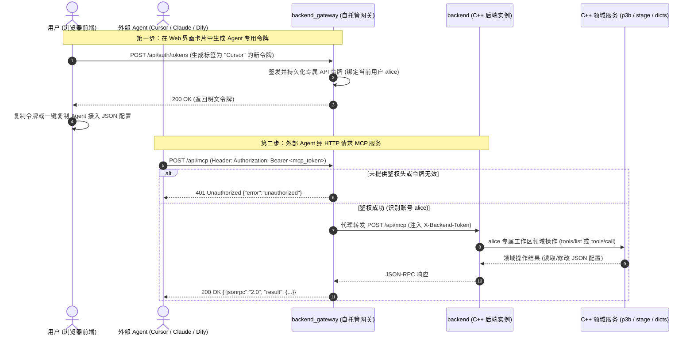

# 新增 Web 端提供 HTTP MCP 服务与令牌生成实施方案

本方案旨在为模组编辑器的 Web 端（含单实例 Web 版与多租户 `backend_gateway` 托管版）增加基于 HTTP 协议的 **MCP（Model Context Protocol）服务**，并强制要求**请求头鉴权**（`Authorization: Bearer <token>` 与 `X-Backend-Token: <token>`），同时在 Web 设置页面提供**专门的「生成令牌」卡片与多 Agent 接入配置生成器**，以便用户通过 Cursor、Claude Code、Claude Desktop、Windsurf、Dify 等外部 Agent 工具无缝接入模组编辑器的数据读取与创作编辑能力。

---

## 一、目标与背景

### 1. 现状分析
1. **MCP 现状**：
   - 目前仓库提供 `tools/mcp_bridge/mcp_bridge.py`，仅支持 **stdio** 传输（子进程换行分隔 JSON-RPC 2.0），适用于桌面本地 CLI/Desktop 环境。
   - 前端内部在 `frontend/lib/features/ai/mcp/` 实现了 MCP Client（客户端），用于让编辑器内置 AI 连接外部第三方 MCP 工具，但**没有向外部暴露 HTTP 服务的 MCP Server**。
2. **Web 端接入痛点**：
   - 网页版（不论是浏览器直接运行的单实例 Web 版，还是基于 `backend_gateway` 的 Linux 远程自托管多账号服务）无法让用户本地运行的外部 Agent（如 Cursor/Claude Code/Dify）通过 stdio 直接调用远端服务。
   - 外部 Agent 接入远程服务的标准方式是 **Streamable HTTP**（POST JSON-RPC 请求）或 **SSE（Server-Sent Events）**。
   - 远程 Web 端直接暴露在网络中，**必须要求请求头鉴权**，以防止未授权访问或越权篡改用户 Mod。
   - **令牌生成体验缺失**：用户接入外部 Agent 时，需要有独立的长效 API 令牌，而不是被迫复制容易过期的临时浏览器 Cookie/Session；前端界面需要有专门的**生成令牌卡片**，让用户直观地创建、复制和管理供 Agent 使用的接入令牌。

### 2. 方案目标
1. **原生提供 HTTP MCP 端点**：
   - 后端新增 `POST /api/mcp` 与 `GET /api/mcp` 端点，全面兼容 MCP 2024-11-05 / 2025-03-26 Streamable HTTP 与 SSE 规范。
   - 完整支持 MCP 核心生命周期：`initialize`、`notifications/initialized`、`ping`、`tools/list`、`tools/call`。
   - 工具集完全对齐 `ai_tools.dart` 与 `mcp_bridge.py`（9 个只读工具 + 4 个写工具，支持读写配置表与剧情舞台调度）。
2. **严密的请求头鉴权与 API 令牌机制**：
   - `native/server/httpd.cpp` 传输层扩展 `token_ok`：除 `X-Backend-Token` 外，原生识别 `Authorization: Bearer <token>` 请求头。无令牌或令牌错误统一拦截并返回 `401 Unauthorized`。
   - 网关层支持长效 API 令牌生成与持久化（`<state_dir>/api_tokens.json`），支持按用户生成专属 Agent 令牌，反向代理时天然按租户隔离。
   - 单机 Web 版支持查询/重置当前外部接入令牌。
3. **前端 Web「生成令牌」卡片与多 Agent 一键配置**：
   - 在前端设置页设计专属**「MCP 外部 Agent 接入与令牌生成」卡片**。
   - 提供「生成新令牌」交互（输入备注如 "Cursor"、选择有效期，生成后展示完整 Token 与复制按钮）。
   - 提供已生成令牌列表与撤回删除能力。
   - 配备「一键复制配置」切换器，自动填充当前 URL 与刚刚生成的 Token，生成适用于 Cursor、Claude Code、Claude Desktop 的完整配置文件片段。
4. **Python 桥接工具补强（`mcp_bridge.py`）**：
   - 补充 `--token`（及 `EDITOR_TOKEN` 环境变量）传参支持，修复此前连接受令牌保护的后端时因无鉴权头失败的问题。
   - 补充 `--http [PORT]` 模式，支持以独立 Python HTTP 桥接服务器形式运行。

---

## 二、架构拓扑与时序



---

## 三、用户评审事项 (User Review Required)

> [!IMPORTANT]
> **关于 MCP 写工具（写回 Mod）的默认开启策略**：
> - 桌面 stdio 版 `mcp_bridge.py` 默认仅开启 9 个只读工具，写工具需显式带 `--allow-write`。
> - 在 Web 端提供 HTTP MCP 时，接入的通常是用户的专属 Coding Agent（如 Cursor / Claude Code），需要具备辅助编辑模组（`update_domain_item`、`create_domain_item`、`delete_domain_item`、`set_talk_stage`）的完整能力。
> - **设计决策**：Web 端 `/api/mcp` 在通过请求头安全鉴权的前提下，**默认开放全部 13 个工具（只读 + 写入）**，同时支持在请求 URL 带 `?readonly=1` 快速切入只读模式。

> [!NOTE]
> **关于「生成令牌」卡片的操作形态**：
> - 网关模式（自托管多用户版）：卡片提供「生成新令牌」弹窗，用户可指定用途标签（如 `Cursor`、`Claude Code`），生成后展示明文并提示复制，服务端加密持久化记录，页面列出所有已发令牌及撤销按钮。
> - 单机 Web 模式（`backend --web-root`）：卡片直接展示并允许重新生成本机的 API Token（与 `.backend_token` 联动）。

---

## 四、拟改动文件与实现细节

### 1. C++ 原生服务端 (`native/server/`)

#### [NEW] `native/server/services/mcp_routes.h`
声明 MCP 路由注册接口：
```cpp
#pragma once
#include "server/httpd.h"

namespace sa {
void register_mcp_routes(Router& r);
}
```

#### [NEW] `native/server/services/mcp_routes.cpp`
实现 MCP 协议处理与工具映射：
- 注册 `POST /api/mcp` 与 `GET /api/mcp`。
- **协议响应**：
  - `initialize`：返回 MCP 协议版本 `2025-03-26`、capabilities、serverInfo。
  - `notifications/initialized`：静默应答 204/200。
  - `ping`：返回空对象 `{}`。
  - `tools/list`：返回 13 个工具 schema（与 `ai_tools.dart` 规范严格同构）。支持 `?readonly=1` 过滤只读工具。
  - `tools/call`：
    - `list_domains` -> `p3b::get_domains()`
    - `get_game_dicts` -> 调用内置字典服务
    - `list_domain_items` -> `p3b::list_domain_items()`
    - `get_domain_item` -> `p3b::get_domain_item()`
    - `update_domain_item` -> `p3b::update_domain_item()`
    - `create_domain_item` -> `p3b::create_domain_item()`
    - `delete_domain_item` -> `p3b::delete_domain_item()`
    - `list_files` -> `p3b::list_dir()`
    - `read_file` -> `p3b::read_file()`
    - `list_mods` -> `sa::list_mods()`
    - `get_stage_dicts` -> `stage::get_stage_dicts()`
    - `get_talk_stage` -> `stage::get_talk_stage()`
    - `set_talk_stage` -> `stage::encode_talk_stage()` 校验并写入 `TalkCfg`
  - 错误处理：捕获 `SandboxError` 与领域异常，按 MCP 协议包装成 `{"content":[{"type":"text","text":"..."}],"isError":true}`。
- **`GET /api/mcp`**：
  - 当带有 `Accept: text/event-stream` 或 `?sse=1` 时，输出 SSE `event: endpoint\ndata: /api/mcp\n\n`。
  - 普通 GET 时返回基础元数据 JSON：`{"status":"ok","mcp":"student-age-editor","protocolVersion":"2025-03-26"}`，方便健康探测。

#### [MODIFY] `native/server/httpd.cpp`
扩展安全鉴权识别逻辑：
- 增强 `token_ok`：除 `X-Backend-Token` 外，原生识别 `Authorization: Bearer <token>` 请求头。

#### [MODIFY] `native/server/api_router.cpp`
- 挂载 `register_mcp_routes(r);`。
- 补充单机模式令牌查询/重置路由：`GET /api/system/token` 与 `POST /api/system/token/regenerate`。

---

### 2. 托管网关 (`native/gateway/`)

#### [NEW] `native/gateway/gw_api_tokens.h` & `gw_api_tokens.cpp`
持久化管理用户生成的长效 API 令牌（保存于 `<state_dir>/api_tokens.json`）：
- 每个令牌包含：`token_hash`（SHA-256 安全散列，明文仅签发一次）、`account`（所属账号）、`label`（备注如 "Cursor"）、`created_at_ms`、`expires_at_ms`（0 = 永不过期）。
- 接口：
  - `issue(account, label, ttl_days, out_token)`
  - `verify(token, out_account)`
  - `list_for_account(account)`
  - `revoke(account, token_id_or_hash)`

#### [MODIFY] `native/gateway/gw_proxy.cpp`
- 注册长效令牌管理端点：
  - `GET /api/auth/tokens`：列出当前用户的 Agent 令牌列表（带掩码）。
  - `POST /api/auth/tokens`：创建新 Agent 令牌，返回明文 `token`。
  - `DELETE /api/auth/tokens/:id`：撤销指定令牌。
- 在 `bearer_account` 鉴权函数中，同时比对 `g.sessions`（临时网页登录）与 `g.api_tokens`（长效 Agent 令牌）。
- 反向代理通配路由自动放行已通过 API 令牌鉴权的 `/api/mcp` 请求。

---

### 3. 前端 Web 设置与「生成令牌」卡片 (`frontend/lib/`)

#### [MODIFY] `frontend/lib/features/settings/settings_page.dart`
在 MCP 设置区域新增专属的**「外部 Agent 接入与令牌生成」卡片**：
1. **令牌生成区（Generate Token）**：
   - 点击「生成新令牌」按钮，弹出浮层：
     - 输入用途备注（默认预填 `Cursor Agent` / `Claude Code`）
     - 选择有效期（30 天 / 90 天 / 长期有效）
   - 提交后调用 `POST /api/auth/tokens`（或单机版对应端点）生成令牌。
   - 浮层展示生成的明文令牌，醒目提示「请立即复制并妥善保管，离开后将不再完整显示」，配一键复制按钮。
2. **已生成令牌列表（Token List）**：
   - 表格/列表展示已创建的令牌：备注、创建时间、状态、到期时间、撤销操作按钮。
3. **Agent 接入配置生成器（Config Generator）**：
   - 切换 Tab 或下拉选择工具：`Cursor` / `Claude Code` / `Claude Desktop` / `cURL`。
   - 动态将生成的 Token 与 `${baseUrl}/api/mcp` 渲染为完整配置代码块：
     - Cursor 配置示例：
       ```json
       {
         "name": "student-age-editor",
         "type": "http",
         "url": "https://<host>/api/mcp",
         "headers": {
           "Authorization": "Bearer <YOUR_TOKEN>"
         }
       }
       ```
     - Claude `.mcp.json` 示例：
       ```json
       {
         "mcpServers": {
           "student-age-editor": {
             "url": "https://<host>/api/mcp",
             "headers": {
               "Authorization": "Bearer <YOUR_TOKEN>"
             }
           }
         }
       }
       ```
   - 提供「一键复制配置」按钮。

---

### 4. Python 桥接服务 (`tools/mcp_bridge/`)

#### [MODIFY] `tools/mcp_bridge/mcp_bridge.py`
1. 增加 `--token` 参数及环境变量 `EDITOR_TOKEN`。在 `http()` 方法中自动携带 `Authorization: Bearer <token>` 头。
2. 增加 `--http [PORT]` 启动模式（默认 8766）：在没有本地 stdio 客户端时，支持以纯 Python 方式独立启动 HTTP MCP 代理。

#### [MODIFY] `tools/mcp_bridge/test_mcp_bridge.py`
补充鉴权请求头透传与 HTTP 桥接模式的单元测试。

---

## 五、验证计划

### 1. 自动化测试 (Automated Tests)
1. **C++ 原生测试 (`native/tests/`)**：
   - 新增 `native/tests/test_mcp_routes.cpp`，挂载入 `sa_tests`：
     - 测试 `POST /api/mcp` 的 `initialize`、`ping`、`tools/list`。
     - 测试各工具调用（只读 `list_domains`、`get_game_dicts`，以及写工具执行结果格式）。
     - 测试鉴权头校验：缺少 token 时返回 `401 Unauthorized`，传入正确的 `Bearer` 或 `X-Backend-Token` 返回 `200 OK`。
     - 测试 API 令牌签发、校验与过期/撤回。
   - 运行命令：
     ```powershell
     .\native\build-native\bin\sa_tests.exe [mcp]
     ```
2. **Python MCP Bridge 单测**：
   - 运行命令：
     ```powershell
     python tools/mcp_bridge/test_mcp_bridge.py
     ```
   - 验证既有 28 项测试及新增的 token 头传递测试全部通过。
3. **前端 Flutter 测试**：
   - 运行设置页与 MCP 客户端测试：
     ```powershell
     flutter test test/mcp_settings_test.dart test/mcp_client_test.dart
     ```

### 2. 手动验证 (Manual Verification)
1. 打开 Web 前端「设置」页面：
   - 查看「外部 Agent 接入与令牌生成」卡片。
   - 点击「生成新令牌」，输入备注并生成，验证明文弹窗与复制功能。
   - 验证配置生成器中的 URL 与 Token 自动组合。
2. 使用 `curl` 验证鉴权拦截：
   ```bash
   # 1. 裸请求无 Token -> 应返回 401
   curl -i -X POST http://127.0.0.1:8765/api/mcp \
     -H "Content-Type: application/json" \
     -d '{"jsonrpc":"2.0","id":1,"method":"tools/list"}'

   # 2. 携带刚刚生成的 Bearer Token -> 应返回 200 及 13 个工具清单
   curl -i -X POST http://127.0.0.1:8765/api/mcp \
     -H "Content-Type: application/json" \
     -H "Authorization: Bearer <生成的TOKEN>" \
     -d '{"jsonrpc":"2.0","id":1,"method":"tools/list"}'
   ```
3. 在 Cursor 或 Claude Code 中粘贴刚刚复制的配置，触发一次工具调用（如获取剧情领域列表），验证外部 Agent 通信正常。
