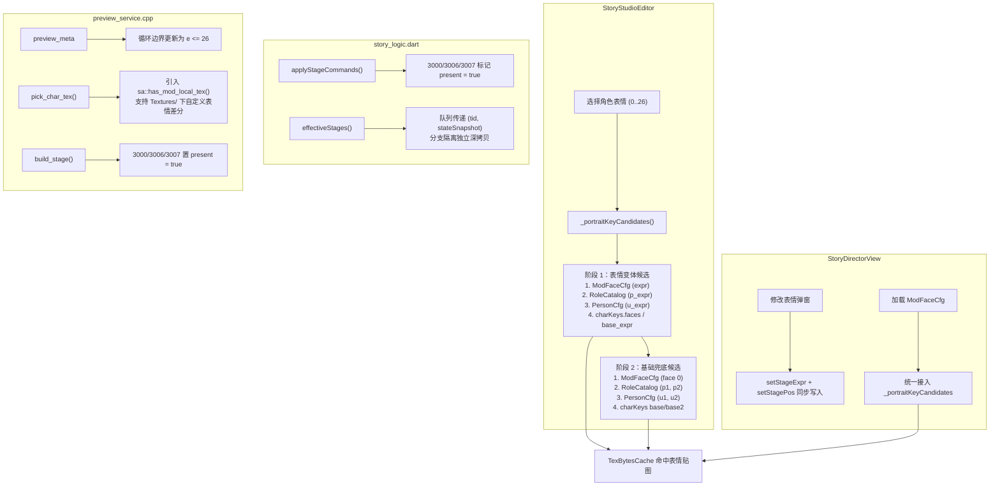

# 修复立绘表情不会变化的问题实施计划

## 问题背景与现象分析

在剧情编辑器中，用户无论是在 **剧情工作台（StoryStudioEditor）** 舞台与侧边属性栏中切换角色表情（0~26），还是在 **经典导演视图（StoryDirectorView）** 中修改表情，或是进入 **事件回放预览（EventPreviewView / `/api/preview/event`）**，经常出现立绘表情**完全没有视觉变化**、始终保持默认无表情或甚至退化回原版素材的现象。

经过对官方客户端源码（`NewTalkView.cs`、`PersonFaceCfg.cs`、`RoleMgr.cs`）、友商竞品（`story.py`）以及本工程前端与后端的端到端审查，发现了以下 **5 个深层根因**：

---

## 根因剖析

### 1. `StoryStudioEditor` 候选立绘优先级反转（基础立绘遮蔽表情变体）
- **代码位置**：[`frontend/lib/features/story/story_studio_editor.dart`](file:///d:/workspace/editor/frontend/lib/features/story/story_studio_editor.dart#L1070-L1180) `_portraitKeyCandidates`
- **机制缺陷**：
  原本的设计意图是「工作区自定义立绘压过官方元数据立绘」，因此把第 2 步 `_roleCatalog` 放在了第 4 步 `charKeys` 前面。
  然而在第 2 步中，不仅加入了表情差分 `${p1}_$expr`，**紧随其后把无表情的基础立绘 `p1`（如 `role_xiaochun`）也加入了候选列表**！
  对于官方角色或未在文件名硬编码 `_2` 后缀的角色，当用户选择表情 2 时：
  - 候选列表为：`['role_xiaochun_2', 'role_xiaochun', ... (charKeys.faces[2])]`
  - 前端缓存 `TexBytesCache` 依次探测：`role_xiaochun_2` 不存在，立即探测到 `role_xiaochun` 存在！
  - **探测命中直接返回基础立绘**，排在第 4 步的 `charKeys['faces']['2']`（真正的官方表情贴图映射）被**永久遮蔽**！
- **次级缺陷**：
  当一个 Mod 角色在 `ModFaceCfg` 中配置了部分表情（如 0、1），当用户点选了未配置的表情 2 时，代码未回退到该 Mod 角色的默认脸（0 号），而是直接穿透到 `_roleCatalog` / 官方 `charKeys`，导致自定义角色立绘瞬间「闪退」变成原版角色或空白。

### 2. `StoryDirectorView` 缺少 `ModFaceCfg` 与 `charKeys.faces` 完整候选链
- **代码位置**：[`frontend/lib/features/story/story_director_view.dart`](file:///d:/workspace/editor/frontend/lib/features/story/story_director_view.dart#L2128-L2132) 及 [L2402-L2436](file:///d:/workspace/editor/frontend/lib/features/story/story_director_view.dart#L2402-L2436)
- **机制缺陷**：
  - `StoryDirectorView` 渲染舞台卡片时，只简单拼装了 `[if (role.expr != 0) '${portraitKey}_${role.expr}', portraitKey]`，根本没有解析 `ModFaceCfg` 或 `charKeys['faces']`，自定义表情完全无法生效。
  - 在 `_showEditRoleActionDialog` 确认修改表情时，仅调用了 `setStageExpr(talk['roles'], role.roleId, pair.$1)`，没有调用 `setStagePos`；对于最初通过 `activeRoleIds` 回退展示的角色，因为其 `talk['roles']` 中缺少 `1001` 入场指令，在 `parseStageChars` 解析时被判定为不在场而丢弃，导致 UI 刷新后槽位重置回 0 号默认表情。

### 3. `story_logic.dart` 中单对白动作指令丢失 `present` 标记
- **代码位置**：[`frontend/lib/features/story/story_logic.dart`](file:///d:/workspace/editor/frontend/lib/features/story/story_logic.dart#L587-L612) `applyStageCommands` & `parseStageChars`
- **机制缺陷**：
  - `applyStageCommands` 中，`touch()` 默认生成的 `StageCharState` 其 `present` 为 `false`。
  - 仅有 `1001/1002/1003` 将 `present` 置为 `true`；而 `3000`（表情）、`3006`（换装）、`3007`（镜像）仅修改了对应属性，未更新 `present = true`。
  - 导致单句对白中只有 `[roleId, 3000, expr]` 时，`parseStageChars` 输出为空，角色在舞台直接消失或降级。

### 4. `effectiveStages` 分支 BFS 状态交叉污染
- **代码位置**：[`frontend/lib/features/story/story_logic.dart`](file:///d:/workspace/editor/frontend/lib/features/story/story_logic.dart#L622-L660) `effectiveStages`
- **机制缺陷**：
  - BFS 遍历队列中仅存 `tid`（对白 ID），所有节点共享同一个外部可变 `state` Map。
  - 当剧情出现选项分支（分支 A 与分支 B）时，分支 A 中设置的表情或出退场会直接串入分支 B，导致不同分支的表情状态错乱。

### 5. 后端 `preview_service.cpp` 中本地 Mod 贴图探测遗漏与 26 号表情边界
- **代码位置**：[`native/server/services/preview_service.cpp`](file:///d:/workspace/editor/native/server/services/preview_service.cpp#L422) 与 [L535-L555](file:///d:/workspace/editor/native/server/services/preview_service.cpp#L535-L555)
- **机制缺陷**：
  - `pick_char_tex()` 在匹配候选贴图时，只检查了 `idx`、`pstore` 和 `pack_store`，**漏掉了 `sa::has_mod_local_tex(t)`**！因此存放在工作区 `Textures/` 下的角色表情差分在预览构建时无法匹配，直接回退基础立绘。
  - `preview_meta` 差分探测循环为 `e <= 25`，漏掉了游戏官方定义的 26 号表情（`尴尬`）。

---

## 修复架构与实施方案

---

## 详细实施步骤

### 步骤 1：重构 `StoryStudioEditor._portraitKeyCandidates` 候选优先级
- **目标文件**：[`frontend/lib/features/story/story_studio_editor.dart`](file:///d:/workspace/editor/frontend/lib/features/story/story_studio_editor.dart)
- **修改要点**：
  1. 将候选解析严格解耦为两组：
     - **第一组：表情变体候选（仅在 `expr > 0` 时注入）**：
       - `_faceCfg` 中匹配当前 `pid` 且 `fid % 100 == expr` 的 `icon` / `icon_xx`；
       - `_roleCatalog` 中的 `${p}_$expr`；
       - `_personCfg` 中的 `${u}_$expr`；
       - `charKeysMapOrNull[id]['faces'][expr]` 的 `icon` / `icon_xx` 以及 `${base}_$expr` / `${base2}_$expr`。
     - **第二组：基础立绘回退候选（变体均未命中或 `expr == 0` 时兜底）**：
       - `_faceCfg` 中当前 `pid` 的 0 号默认脸（保证自定义角色不会穿透回原版）；
       - `_roleCatalog` 的 `p1` / `p2`；
       - `_personCfg` 的 `u1` / `u2`；
       - `charKeysMapOrNull` 的 `base` / `base2`。
  2. 保证同一组内工作区自定义素材优先于随包官方素材，杜绝基础立绘「抢跑」截断表情变体。

### 步骤 2：对齐 `StoryDirectorView` 表情解析与舞台指令写回
- **目标文件**：[`frontend/lib/features/story/story_director_view.dart`](file:///d:/workspace/editor/frontend/lib/features/story/story_director_view.dart)
- **修改要点**：
  1. 在 `_loadConfigs` 中同步加载 `ModFaceCfg`（存储至 `_faceCfg`）；
  2. 将 `_StageRoleCard` 中的 `keyCandidates` 改用完整的 `_portraitKeyCandidates` 解析器，覆盖 `ModFaceCfg` 与 `charKeys.faces`；
  3. 在 `_showEditRoleActionDialog` 中，保存表情时若角色已有位置，调用 `setStagePos(r, role.roleId, role.pos)`，确保角色入场指令与表情指令完整成对，不丢失舞台槽位。

### 步骤 3：修复 `story_logic.dart` 中动作指令与 BFS 分支隔离
- **目标文件**：[`frontend/lib/features/story/story_logic.dart`](file:///d:/workspace/editor/frontend/lib/features/story/story_logic.dart)
- **修改要点**：
  1. **动作指令在场标记**：在 `applyStageCommands` 中，当 `tid == 3000`（表情）、`3006`（换装）、`3007`（镜像）时，确保 `e.present = true`，避免独立指令在 `parseStageChars` 中被误丢弃。
  2. **分支状态快照隔离**：在 `effectiveStages` 中，将 BFS 队列改为 `(String tid, Map<String, StageCharState> stateSnapshot)`，每个子节点分支继承父节点状态的独立拷贝，彻底解决分支状态串扰。

### 步骤 4：修复后端 `preview_service.cpp`
- **目标文件**：[`native/server/services/preview_service.cpp`](file:///d:/workspace/editor/native/server/services/preview_service.cpp)
- **修改要点**：
  1. `preview_meta` 探测循环由 `e <= 25` 调整为 `e <= 26`；
  2. `pick_char_tex` 中将 `sa::has_mod_local_tex(...)` 纳入可用源判断 `has_sources`、候选遍历及 `in_sources` 回退判断；
  3. `build_stage` 中在处理 `tid == 3000`、`3006`、`3007` 时标记 `st["present"] = true`。

### 步骤 5：单元测试与回归验证
- **目标文件**：
  - [`frontend/test/story_logic_test.dart`](file:///d:/workspace/editor/frontend/test/story_logic_test.dart)
  - [`frontend/test/story_studio_test.dart`](file:///d:/workspace/editor/frontend/test/story_studio_test.dart)
- **测试覆盖**：
  1. 单测验证：`parseStageChars` 解析仅含 `[role, 3000, 2]` 的行正确输出角色与表情；
  2. 单测验证：`effectiveStages` 在选项二分支场景下，分支 A 改变表情不污染分支 B；
  3. 单测验证：`_portraitKeyCandidates` 输入包含 `faces` 映射的角色时，表情候选排在基础立绘之前；
  4. 运行 `flutter test` 与 C++ 单元测试套件，保证全部测试绿灯通过。

---

## 验证指标与准则

1. **界面交互验证**：
   - 在 `StoryStudioEditor` 舞台上点击角色，切换 0~26 任意表情，立绘能即时切换为差分贴图（存在差分或 ModFaceCfg 时）或安全平滑降级（无差分时回退 0 号）；
   - 在 `StoryDirectorView` 点击角色表情徽章切换表情，立绘头像框能正确更新，不发生角色位移或重置为 0；
2. **预览服务验证**：
   - 携带 `[role, 3000, 26]` 等表情的对白通过 `/api/preview/event` 预览时，返回的舞台角色包含正确的 `expr` 与对应 `tex`；
3. **自动化测试**：
   - `flutter test test/story_logic_test.dart`
   - `flutter test test/story_studio_test.dart`
   - 全部测试通过无报错。
