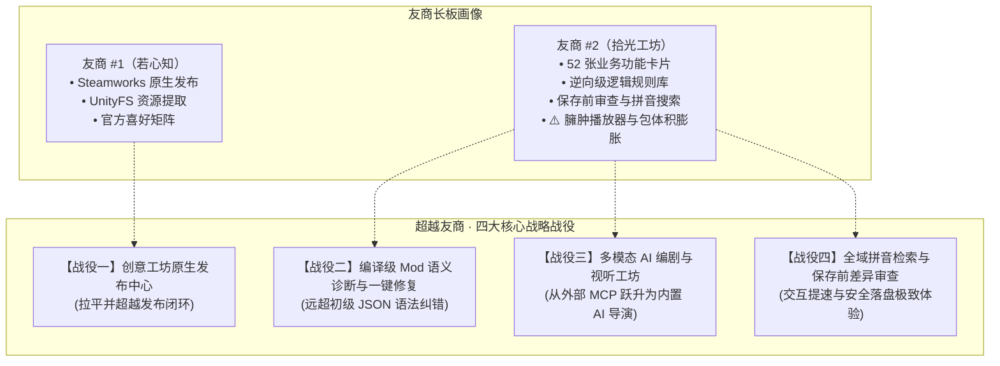

# “超越友商”系统性实施计划 (Surpass Competitors Plan) - v2

## Goal Description

本项目（学生时代模组编辑器）已经在核心底座与架构层面建立了强大壁垒：采用 **Native C++20 + Flutter**，实现了毫秒级冷启动、极低内存占用、零 Python 运行时依赖，并覆盖 **Windows、macOS、Linux、Android（手机端全功能）、Web（本地 & 自托管网关）、CLI、TUI** 八大形态，拥有 12+ 专属工作台和业界首创的全场景无代码积木 DSL。

但在生态闭环与创作效率维度，两位行业友商仍有其独特长板与用户诉求：
1. **友商 #1（若心知）**：依托 Steamworks 原生 SDK 实现 **Steam 创意工坊一键发布与订阅管理**，具备 UnityFS/Addressables 资源即时解包；
2. **友商 #2（拾光工坊 StudentAge Studio）**：打造了 52 张业务卡片导演模式、反编译逆向级条件效果规则库、MCP 外部 AI 介入、以及 **保存前差异审查、全域拼音搜索** 等实用细节。

本计划旨在**全面补齐友商核心功能闭环，并在智能化、工程质量、交互效率与多端生态四大维度建立代差级领先优势（10x 体验）**。

> [!IMPORTANT]
> **架构决策记录 (ADR · 坚守单一用途与轻量化原则)**：
> 友商 #2 在发行包中硬打包音乐播放器与音频文件，导致安装包体积暴增、功能臃肿。本项目**坚决放弃“沉浸式创作电台/背景音乐播放器”等与 Mod 编辑无关的冗余特性**，严格恪守 **“专注编辑器核心职责、极小安装包、秒级冷启、零无关资源污染”** 的工程铁律。

---



---

## User Review Required

> [!IMPORTANT]
> **Steam 创意工坊发布机制与版权合规**：
> 友商 #1 与 #2 均采用动态探测用户电脑中游戏本体或 Steam 客户端自带的 `steam_api64.dll`，自身不分发 Valve 商业闭源 DLL，仅使用 MIT 授权的轻量桥接封装。我们桌面端 native 后端将沿用此合规方案（动态 `LoadLibrary` / `dlopen`），避免分发侵权。非桌面端（Web/Android）则提供“导出脱敏创意工坊标准包”并提示使用桌面版发布。

> [!TIP]
> **分期交付策略**：
> - **第一阶段 (Phase 1 · 核心短板清零 & 交互提速)**：Steam 创意工坊发布中心、全域拼音与首字母极速搜索、保存前可视化差异审查面板；
> - **第二阶段 (Phase 2 · 质量工程与全真仿真)**：编译级 Mod 语义诊断引擎 (Linter) 与一键修复 (QuickFix)、剧情舞台 Live2D 动态演出与手机界面全真仿真；
> - **第三阶段 (Phase 3 · AI 导演与跨端分发)**：自然语言大纲一键裂变剧情树、全篇角色口吻 (OOC) 智能审查、GUI 全篇 AI 配音视听工坊、跨端一键分发中心。

---

## Open Questions

> [!NOTE]
> 1. **关于 Steam 创意工坊标签**：当前游戏工坊主要标签为 `剧情` 和 `其他`。是否需要允许作者自定义子标签并自动检测 Mod 内容推荐标签？
> 2. **关于跨端分发导出**：在 Android 和 Web 端，除导出标准 ZIP 外，是否需要提供直接生成“局域网同步二维码”供其他设备即扫即测？

---

## Proposed Changes

---

### 一、战役一：Steam 创意工坊原生发布中心 (Workshop Publishing Center)

彻底解决当前创作者写完 Mod 后必须手动打包 zip 或切回若心知才能发布的痛点。

#### [NEW] `native/server/services/workshop_service.h` / `native/server/services/workshop_service.cpp`
- **动态加载 `steam_api64.dll`**：借助 `sa_core::steam_paths` 探测 Steam 安装目录与游戏目录；
- **发布流程自动化状态机**：
  1. `Validate`: 检查 Mod 结构有效性（必须有 `manifest.json`、有效封面）；
  2. `Staging`: 自动创建安全脱敏上传副本（排除 `.save.lock`、`Backups/`、`workshop.json`、临时文件）；
  3. `CreateOrReuse`: 检测 `workshop.json` 侧栏文件，若无则调用 `CreateItem` 分配新 `PublishedFileId`，若有则复用更新；
  4. `SetContent`: 更新标题、描述、可见性（公开/仅好友/私密）、标签（剧情/其他）、内容目录、封面预览图；
  5. `Submit`: 提交上传并启动后台轮询进度线程，返回进度百分比（0~100%）与阶段状态；
- **暴露 HTTP API**：
  - `GET /api/workshop/status`: 检测 Steam 客户端是否运行、DLL 是否就绪；
  - `POST /api/workshop/publish`: 启动异步发布任务；
  - `GET /api/workshop/publish-progress`: 获取当前发布进度与详情；
  - `POST /api/workshop/publish-cancel`: 取消正在进行的发布。

#### [NEW] `frontend/lib/features/mods/workshop_publish_dialog.dart`
- 现代化 Fluent 风格的发布抽屉/对话框：
  - 封面选择与即时裁剪预览（严格控制在 1MB 以内）；
  - 标题、简介输入框与字符计数；
  - 可见性下拉选择（公开、仅好友、私密）；
  - 更新日志说明（Change Note）；
  - 高级折叠面板：查看/绑定已有工坊 PublishedFileId；
  - 进度指示器：细粒度展示“预处理数据 → 打包上传 → 提交变更 → 完成”，并提供一键跳转至 Steam 创意工坊网页。

#### [MODIFY] `frontend/lib/features/mods/mods_page.dart`
- 在顶部操作栏（新建/导入/导出）新增 **「发布到创意工坊」** 显式按钮；
- 列表中针对已发布的 Mod 渲染 Steam 工坊专属角标与状态。

---

### 二、战役二：编译级 Mod 语义诊断与一键修复引擎 (Mod Linter & Auto-Fix)

友商 #2 的 `config_doctor` 仅做 JSON 逗号语法纠错，友商 #1 的 `bug_fixer` 仅修特定旧版字段。我们要打造首个 **Mod 语言服务器级 (LSP) 静态语义诊断器**。

#### [NEW] `native/server/services/semantic_linter.h` / `semantic_linter.cpp`
- **五大维度深度静态诊断规则**：
  1. **拓扑断链 (Topological Deadends)**：检测不可达事件 (Unreachable Nodes)、悬空跳转 (Target Event ID 不存在)、死循环跳转无退出条件；
  2. **跨表引用完整性 (Foreign Key Integrity)**：检测剧情/任务中引用的 `PersonID`、`ItemID`、`ShopID`、`ActionID` 是否在底层表中被删除；
  3. **多媒体资产坏链 (Dangling Media References)**：检测指定的立绘表情名称（如 `xiaoyi_angry`）或背景图（`bg_classroom_night`）在游戏原版和当前 Mod 素材库中是否均缺失；
  4. **逻辑规则互斥 (Logical Contradictions)**：检测同一节点的前置条件中是否存在互斥断言（如“好感度 > 80”且同时要求“好感度 < 30”）；
  5. **数值与格式越界 (Range & Overflow)**：检测 32 位整型溢出、必填字段留空、ID 格式非法。
- **一键智能修复动作 (QuickFix Actions)**：
  - `FixDanglingRef`: 引用不存在的立绘时，自动回退到人物基础默认立绘；
  - `CreateMissingEvent`: 跳转到不存在的 7 位事件 ID 时，一键在图上创建缺省占位事件节点；
  - `PruneOrphanNodes`: 一键归档或安全删除未被任何入口引用的孤立废弃节点。
- **性能约束**：纯后台单次触发遍历（耗时 < 5ms），常驻内存增量 0。

#### [MODIFY] `frontend/lib/features/bugfix/bugfix_panel.dart`
- 将原有的简单列表重构为 **工程级诊断面板 (Diagnostic Center)**：
  - 顶部健康分指数（0~100 分仪表盘）；
  - 分类 Tab：全部、错误 (Error)、警告 (Warning)、建议 (Info)；
  - 每一项问题附带精准定位（点击一键高亮跳转至对应工作台/剧情图节点/表字段）；
  - 提供单项 **「一键修复」** 与全局 **「全部安全修复」** 按钮。

---

### 三、战役三：多模态 AI 编剧与视听工坊 (AI Story Studio & TTS)

从“提供 MCP 接口让外部大模型手动改表”降维打击到“编辑器内置的一站式 AI 联合导演”。

#### [NEW] `frontend/lib/features/ai/ai_script_generator.dart`
- **大纲裂变为剧情图 (Outline to Storyflow)**：
  - 创作者输入一段自然语言故事情节（例如：“主角在天台偶遇哭泣的林晓，有三个对话分支：安慰、默默递纸巾、追问原因”）；
  - AI 自动生成包含剧情分支、登场人物、立绘表情、选项判断条件的完整剧情节点拓扑；
  - 提供生成前预览与节点级选择性合并到当前工程。
- **角色口吻一致性审查 (Character Persona & OOC Audit)**：
  - 提取人物的性格特征与说话习惯；
  - 批量扫描该人物的所有台词，标记疑似“OOC（Out Of Character）”的违和对白，并提供契合人设的润色改写选项。

#### [NEW] `frontend/lib/features/story/story_studio_tts_panel.dart`
- 打通 Native 后端已有的 `tts.cpp`（内置 Minimax 与阿里 DashScope 引擎）：
  - 在剧情舞台中一键唤起“配音控制台”；
  - 为剧本中的每位登场人物绑定音色（支持男女声、少年、御姐等个性化音色库）；
  - 支持单句实时试听、批量全篇合成音轨、一键生成为 Mod 专属音频资产挂载到对白上。
- **性能约束**：纯异步 HTTP 流式调用，零本地模型权重，零显存常驻。

---

### 四、战役四：全域拼音极速检索与保存前差异审查 (Precision & Efficiency)

大幅缩短选人、选物操作链，杜绝误保存与误覆盖。

#### [NEW] `frontend/lib/core/pinyin_search.dart`
- **全域拼音与首字母极速模糊检索**：
  - 仅收录 3500 常用字紧凑平坦首拼与全拼索引（体积 < 45 KB，常驻内存 < 200 KB）；
  - 支持全拼匹配（`xiaoyi` 匹配 `萧逸`）与首拼匹配（`xy` 匹配 `萧逸`）；
  - 在人物选择器（`entity_picker.dart`）、物品选择器、剧情跳转选择器、无代码 DSL 搜索中全量应用；
  - 候选载入时预计算，输入时匹配延迟 < 0.05ms，丝滑 120fps。

#### [NEW] `frontend/lib/features/editor/save_review_drawer.dart`
- **保存前可视化差异审查 (Visual Save Review)**：
  - 监听 Ctrl+S 或保存操作；
  - 若检测到多项修改，弹出优雅的侧边抽屉，直观展示本次保存涉及的修改表、新增条目、修改字段前后 Diff（红绿高亮对比）；
  - 支持勾选/取消勾选特定表，单项撤销后安全落盘，并自动记录版本快照。
  - **性能约束**：复用 C++ 原生 `cfg_store` 脏字段跟踪，无整表深拷贝，Diff 耗时 < 1ms。

---

### 五、跨端全真沙盒演播与分发枢纽 (Simulation & Distribution Hub)

#### [MODIFY] `frontend/lib/features/preview/event_preview_view.dart` & `stage_effects.dart`
- **全真舞台仿真**：
  - 激活 Native C++ Live2D 动态渲染器：人物立绘支持呼吸动作、表情平滑过渡、说话口型同步；
  - 还原原版游戏的全套舞台滤镜（黑屏渐入、震屏特效、闪光回想、雨雪粒子天气）；
  - 视口可见时渲染，后台自动休眠，提供低配静态立绘降级开关。

#### [NEW] `frontend/lib/features/mods/mod_distribution_hub.dart`
- **跨端一键分发中心**：
  - Steam 创意工坊一键发布；
  - 移动端扫码即玩（生成专属局域网二维码或直链，手机端编辑器/测试机扫码自动载入）；
  - 自托管 Web 在线试读链接一键生成；
  - 云盘多端备份（一键打包同步至绑定的 WebDAV / 百度网盘）。

---

## 路线图排期与里程碑 (Roadmap & Milestones)

| 里程碑 | 核心任务 | 交付标志与成效 |
| :--- | :--- | :--- |
| **M1: 闭环补齐与交互提速** (Week 1) | 1. 接入 Steamworks 创意工坊发布对话框与 Native 桥接<br/>2. 实现全域常用字拼音与首拼紧凑检索<br/>3. 实现保存前可视化差异审查抽屉 (Save Review) | 创作者无需切换任何外部工具即可直接发布到 Steam 创意工坊；日常搜索与保存体验超越友商。 |
| **M2: 质量工程与全真演播** (Week 2) | 1. 构建编译级 Mod 语义诊断引擎 (Semantic Linter)<br/>2. 打造一键智能修复面板 (QuickFix Actions)<br/>3. 剧情舞台连通 Native Live2D 动态呼吸与口型<br/>4. 完善原版手机系统与屏幕特效全真仿真 | 彻底解决 Mod 引用断链与坏死逻辑；剧情预览做到 100% 还原游戏实机，甩开友商。 |
| **M3: AI 导演与生态代差** (Week 3) | 1. 大纲一键裂变多分支剧情图拓扑<br/>2. 角色口吻 (OOC) 与性格一致性智能审计<br/>3. GUI 全篇 AI 配音视听工坊 (Minimax/DashScope TTS)<br/>4. 跨端一键分发中心（移动端扫码试玩 / Web 在线试读） | 建立不可替代的 AI 核心生产力，形成全平台跨端体验的绝对壁垒。 |

---

## Verification Plan

### Automated Tests
1. **Native 单元与集成测试**：
   - 运行 native 后端测试集，验证 Steam 路径探测与脱敏打包逻辑：
     ```powershell
     cd d:\workspace\editor
     ctest --test-dir native/build --output-on-failure
     ```
   - 验证语义诊断引擎规则覆盖（断链引用、拓扑死锁检测）：
     ```powershell
     .\native\build\tests\Debug\sa_tests.exe --gtest_filter="SemanticLinterTest.*"
     ```
2. **Flutter 前端测试**：
   - 验证拼音搜索匹配器、差异审查组件与发布抽屉渲染：
     ```powershell
     cd frontend
     flutter test test/pinyin_search_test.dart
     flutter test test/save_review_test.dart
     flutter test test/workshop_publish_test.dart
     ```

### Manual Verification
1. **Steam 创意工坊发布测试**：
   - 在 Windows 环境下打开模组管理页，点击「发布到创意工坊」，验证封面裁剪、标题填写、标签选择；
   - 触发测试发布流程，验证打包脱敏是否完整排除私有目录，验证后台上传进度条与 Steam 状态反馈。
2. **拼音极速检索测试**：
   - 在人物选择器中输入 `xy` 或 `xiaoyi`，验证能否秒级筛选出“萧逸”；在物品选择器中输入首拼验证匹配准确性。
3. **差异审查与保存测试**：
   - 修改两个工作台的数据后按 Ctrl+S，验证差异审查抽屉是否正确展示改动的表与字段前后高亮，测试单项撤销与确认保存。
4. **Mod 语义体检与一键修复**：
   - 刻意在剧情中配置一个不存在的人物理绘或不可达跳转，打开诊断中心，验证错误是否秒级检测出，点击「一键修复」验证是否自动回退并修复。
5. **AI 剧情裂变与视听体验**：
   - 输入测试剧情大纲，点击生成，验证分支拓扑是否合理构建并能流畅在剧情舞台中进行动态预览与 TTS 语音播放。
